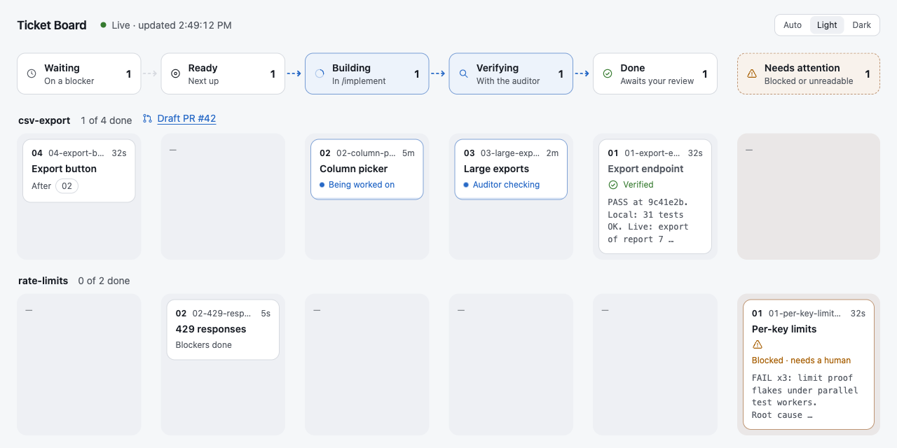

# Agentic Engineering

A Claude Code and Codex plugin that gives a repository a short, accurate agent harness, fitted to that repo: a root guide, an architecture map, a spec → implement workflow with a fresh-context verifier, and an optional live ticket board.

<p align="center">
  <picture>
    <source media="(prefers-color-scheme: dark)" srcset="docs/images/dashboard-dark.png">
    
  </picture>
  <br>
  <sub>The optional ticket board, showing tickets moving through the workflow.</sub>
</p>

## What it does

You run one command in a repo. The agent reads the codebase, finds the real test commands, boundaries and conventions, and writes:

- **`AGENTS.md`** (with `CLAUDE.md` pointing at it): invariants, real commands, patterns. Short and operational.
- **`ARCHITECTURE.md`**: components, flow, and contracts.
- **Nine workflow skills** in `.claude/skills/`, each filled in with this repo's own test seams and commands.
- **A `harness-verifier` agent** that checks finished work in a fresh context, on two separate axes (does it meet the spec; does it meet the repo's standards).
- **The ticket board** (only if you say yes when asked).

Claude Code and Codex share one copy of everything. Codex reads the same skills through a symlink, so the two never drift apart.

Each piece answers a failure that teams running coding agents keep reporting. See [The research behind it](#the-research-behind-it).

## Install

**Claude Code**

```
/plugin marketplace add jteerlink/agentic-engineering
/plugin install agentic-engineering@agentic-engineering
```

**Codex**

```
codex plugin marketplace add jteerlink/agentic-engineering
codex plugin add agentic-engineering@agentic-engineering
```

Start a new session afterwards; a session that was already open doesn't see new plugins.

> **Private repo?** Installs use a normal `git clone`, so they work for anyone whose git login can read this repo. If `git clone https://github.com/jteerlink/agentic-engineering.git` works for you, the install will too.

## Quick start

From the root of the repo you want to set up:

```
/agentic-engineering:agentic-engineering
```

In Codex, ask for the skill by name ("use the agentic-engineering skill to set up this repo") or pick it from the skills list.

The agent inspects the repo, asks whether you want the ticket board, then writes:

```text
AGENTS.md
CLAUDE.md                        @AGENTS.md
ARCHITECTURE.md
docs/harness/workflow.md
docs/harness/dashboard.html      only if you said yes
docs/adr/0001-<slug>.md          only when a real boundary exists
.claude/skills/<9 skills>/SKILL.md
.claude/agents/harness-verifier.md
.codex/agents/harness-verifier.toml
.agents/skills -> ../.claude/skills
.gitignore                       + .scratch/, .agents/, .claude/
```

It finishes by checking its own work: no unfilled placeholders, the Codex link resolves, and the repo's test suite still passes.

Run it again at any time to bring an existing harness up to date. It updates files in place and migrates older harness layouts.

> `.claude/` and `.agents/` are added to `.gitignore`, so the skills are local to whoever ran the command. Teammates get `AGENTS.md`, `ARCHITECTURE.md` and the workflow doc from git; to get the skills, they install the plugin and run the command themselves.

## The workflow

<picture>
  <source media="(prefers-color-scheme: dark)" srcset="docs/images/workflow-dark.png">
  
</picture>

<sub>Source: <a href="docs/images/workflow.html">docs/images/workflow.html</a>. Edit it, then re-screenshot it with <code>?theme=light</code> and <code>?theme=dark</code>.</sub>

Plans are ephemeral: a spec lives at `.scratch/<slug>/spec.md` (gitignored) and `/retro` deletes it after merge. What lasts goes into tests, `docs/adr/` (decisions that are hard to reverse) and `GLOSSARY.md` (domain terms, created the first time one comes up).

### Example: a small fix

Skip the spec. Describe the fix and let `/implement` take it test-first:

```
/implement Pagination drops the last item when the total is an exact multiple of the page size
```

It writes a failing test, makes the smallest change, runs the repo's test gate, gets a verdict from `harness-verifier`, and hands back a PR description. It commits or opens a PR only when you ask.

### Example: a feature

```
/grill-with-docs   We need CSV export for reports
```

The agent asks numbered questions with recommended answers ("Which columns? Recommended: the ones visible in the table"). Terms and decisions get written to `GLOSSARY.md` and `docs/adr/` as they settle. Skip this step when the request is already clear.

```
/to-spec
```

This turns the conversation into `.scratch/csv-export/spec.md`. Every "Done when" item comes with a command that fails today and must pass afterwards:

```md
# CSV export for reports
Status: approved

## Done when
- [ ] GET /reports/:id/export.csv returns the report as CSV — proof: `pytest tests/test_export.py` (fails today)

## Must not change
- [ ] Existing behavior stays the same — proof: `make test`
```

```
/implement .scratch/csv-export/spec.md
```

It runs the "Must not change" proofs first and stops if they are already red. Then it builds red-first, repairs at most 3 times per proof, and logs the verifier's verdict in the spec. Local and live results are recorded separately, so "not run" is never reported as "passed".

### Example: work that spans sessions

When a spec is too big for one session, split it into tickets:

```
/to-tickets .scratch/csv-export/spec.md
```

You review a numbered list of vertical slices and the dependencies between them. Each approved slice becomes a file:

```md
# 02: Column picker
Blocked by: 01
Status: ready

Users choose which columns the export includes.

## Done when
- [ ] Export honours ?columns= — proof: `pytest tests/test_export.py -k columns` (fails today)
```

Then let it run unattended:

```
/run-tickets .scratch/csv-export/spec.md
```

It works through every ready ticket in one git worktree (`.claude/worktrees/csv-export`). Each ticket goes through `/implement`, gets one commit, and is pushed to **one draft PR for the whole spec**. The run stops at the first blocked ticket and tells you what a human needs to do. It never merges, never marks the PR ready, and never deploys. Running it again resumes where it stopped.

### Example: a bug

```
/diagnosing-bugs  The nightly import sometimes writes duplicate rows
```

It builds a loop that reproduces the failure on demand before it forms any hypothesis. A small fix it makes itself, then runs `harness-verifier` on the diff; a bigger one goes through `/to-spec` → `/implement`.

## Commands

| Command | Use it when |
|---|---|
| `/grill-with-docs` | Scope, a domain rule, or what counts as done is unclear. Interviews you in rounds; writes terms and ADRs. |
| `/to-spec` | You've agreed what to build. Writes `.scratch/<slug>/spec.md` with a failing proof for every goal. |
| `/to-tickets` | The spec won't fit one session. Splits it into ticket files with dependencies. |
| `/implement <spec, ticket, or description>` | Building anything: test-first, verified, logged. |
| `/run-tickets <spec>` | You want the tickets worked unattended into one draft PR. |
| `/tdd` | Used by `/implement`; also on its own for test-first work. |
| `/diagnosing-bugs` | Something is wrong, flaky, or slow. |
| `/handoff` | The work moves to another tool (Claude ↔ Codex), directory, or person. |
| `/retro` | After a session, to propose checks, navigation pointers, verifier rules and `AGENTS.md` trims for next time. It also deletes merged specs and tickets from `.scratch/`, after you confirm. |

These are installed into the repo, so you call them by their short names. Only the installer, `/agentic-engineering:agentic-engineering`, carries the plugin prefix.

## Ticket board

Say yes when the installer asks, and the board is installed at `docs/harness/dashboard.html`. `/run-tickets` starts it in the background and gives you the link. Outside a run, ask the agent to start the ticket board, or run it yourself from the repo root:

```
ln -sf ../docs/harness/dashboard.html .scratch/dashboard.html
python3 -m http.server 8765 --bind 127.0.0.1 -d .scratch
```

Then go to http://127.0.0.1:8765/dashboard.html.

- **One row per spec**, with tickets lined up under **Waiting → Ready → Building → Done**. Blocked tickets and tickets with an unrecognised status go to **Needs attention**, so they never silently disappear.
- **Motion only where work is happening:** the arrows into and out of Building animate, and building cards show "Being worked on". If nothing is building, nothing moves.
- **Finished specs fold away:** a spec whose tickets are all done moves into a collapsed **Finished specs** section. `/retro` deletes it once its PR is merged.
- **Stale is obvious:** if the server stops answering, a banner appears, the last good view stays, and all animation stops.
- **Light, dark, or follow the system**, from the switch in the top right. Reduced-motion settings are respected.

It is read-only (no buttons, no drag). It loads nothing from the network and serves only `.scratch/` on localhost. Ticket text is rendered as plain text, never as HTML.

## Updating

When a new version is published:

```
# Claude Code (restart Claude afterwards)
claude plugin marketplace update agentic-engineering
claude plugin update agentic-engineering@agentic-engineering

# Codex
codex plugin marketplace upgrade agentic-engineering
codex plugin add agentic-engineering@agentic-engineering
```

That updates the installer. Repos you've already set up keep their copies until you run `/agentic-engineering:agentic-engineering` in them again.

## Troubleshooting

**"Unknown command: /agentic-engineering"**
- Start a new session: plugins installed or changed while a session is open aren't loaded into it.
- Use the full name, `/agentic-engineering:agentic-engineering`.
- Check that the plugin is enabled: `claude plugin list` (Claude Code) or `codex plugin list` (Codex).

**Install fails with "repository not found" or a 404:** your git login can't read this repo. If you're signed in to several GitHub accounts, check which one git uses.

**An update didn't arrive:** installs are cached by version. A change only reaches users once `version` is bumped in both `plugin.json` files.

**`{{repo: ...}}` placeholders left in `.claude/`:** the installer couldn't find a value for them. Run it again, or fill them in yourself and delete any line that doesn't apply.

## Maintaining this plugin

```
python3 -m unittest discover -s tests   # offline test gate
claude plugin validate .                # manifest check
```

To release: bump `version` in `.claude-plugin/plugin.json` and `.codex-plugin/plugin.json` together (a test fails if they differ), then push to `main`. How the repo is laid out: [ARCHITECTURE.md](ARCHITECTURE.md). Rules for changing it: [AGENTS.md](AGENTS.md).

## The research behind it

Teams that run coding agents keep reporting the same eight ways it goes wrong. Each part of the harness exists to fix one of them:

| What goes wrong | The pattern | How the harness does it |
|---|---|---|
| A failure gets "fixed" by rewording the prompt | **Fix the harness, not the prompt** [1,2,5]: treat each failure as a missing rule, tool, or test | Add an Invariant, a Pattern, or a proof |
| Long docs go stale and crowd the context | **A map, not a manual** [1,2,5]: a short index that points to the right files | A short `AGENTS.md` and `ARCHITECTURE.md` |
| Agents guess at data and runtime state | **Tools over prose** [2,3,5]: check real state by running commands | Read-only Inspect commands in `AGENTS.md` |
| Lessons stay in one chat and get repeated | **Learn once, enforce always** [2,4,5]: repeated corrections become rules every session loads | Same mistake twice → one new rule (`/retro`) |
| "Done" is decided after the code is written | **Define done before code** [1,4,5]: agree on observable criteria and runnable checks first | `/to-spec`: every goal gets a proof that fails today |
| Long tasks drift and lose progress | **One feature, state on disk** [3,4]: one scoped unit at a time, with progress kept in files | One `.scratch` spec, or one ticket, with its own Log |
| Agents grade their own work too kindly | **The builder is not the checker** [4,5]: a fresh agent verifies; builders never approve themselves | `harness-verifier` reruns the proofs in a fresh context |
| Agents take risky actions without asking | **Humans steer, agents execute** [1,2,5]: people set intent and approve risk | Approval gates; commits only on request; never merges |

Sources:
1. Osmani, Saboo & Kartakis, [*The New SDLC With Vibe Coding*](https://drive.google.com/file/d/1IR7CddF_2FyQo_PdfBNTaEA50EGiVt2r/view) (2026)
2. OpenAI, [Harness engineering](https://openai.com/index/harness-engineering/) (2026)
3. Anthropic, [Effective harnesses for long-running agents](https://www.anthropic.com/research/effective-harnesses-for-long-running-agents) (2025)
4. Anthropic, [Harness design for long-running apps](https://www.anthropic.com/research/harness-design-long-running-apps) (2026)
5. Meta, [AI-native engineering](https://engineering.fb.com/2026/10/15/ml-applications/how-meta-built-forum-ai-native-engineering/) (2026)

The full story is a 12-slide deck: [docs/presentation.html](docs/presentation.html). GitHub shows HTML as source, so clone the repo and run `open docs/presentation.html`. Use the arrow keys or Space to move between slides.

## Credits and license

MIT, see [LICENSE](LICENSE). Most workflow skills are adapted from [mattpocock/skills](https://github.com/mattpocock/skills) (MIT); `run-tickets` and the ticket board are original to this repo.
